<p align="center">
  <picture>
    <source media="(prefers-color-scheme: dark)" srcset="docs/brand/logo-light.svg">
    
  </picture>
</p>

<p align="center">
  <a href="https://github.com/lmonteirotech/openomsi-map-packages/releases/latest"></a>
  <a href="LICENSE"></a>
</p>

Map packages for [openOMSI](https://github.com/openOMSI-org/openOMSI): the pre-built picture and the lines of a map, so that
the navigator and the city map show more than the lane network, and the generator that makes them.

A package is one folder, `openomsi-realmap`, next to a map's files. OMSI 2 itself (Omsi.exe) does not read it and ignores it, so
a map made for both games loses nothing. The format is described in [docs/MAP_PACKAGE.md](docs/MAP_PACKAGE.md).

## Compatibility

<p align="center">
  <a href="https://github.com/openOMSI-org/openOMSI"></a>
  <a href="https://github.com/omsimodsbr/depot"></a>
  <a href="https://github.com/lmonteirotech/OmsiLaunch"></a>
</p>

A package is plain data, so more than one program can show it. Where each one stands:

| Program | What it does with a package | Repository |
|---|---|---|
| **openOMSI** | reads it and draws it in the navigator, the city map and the launcher's route map | [openOMSI-org/openOMSI](https://github.com/openOMSI-org/openOMSI) |
| **Project Depot** | compatible: it can read the same folder | [omsimodsbr/depot](https://github.com/omsimodsbr/depot) |
| **OMSI 2** (the original game), through **OmsiLaunch** and **openHUD** | OMSI 2 itself ignores the folder; OmsiLaunch starts the session and openHUD shows the map, the lines and the street over the game | [lmonteirotech/OmsiLaunch](https://github.com/lmonteirotech/OmsiLaunch), [lmonteirotech/openHUD-for-omsilaunch](https://github.com/lmonteirotech/openHUD-for-omsilaunch) |

## Brand

**openOMSI** (the name and its logo) belongs to the openOMSI project: [openOMSI-org/openOMSI](https://github.com/openOMSI-org/openOMSI),
released under the MIT licence, copyright of its author. The logo of this repository (`docs/brand/`) is made from the openOMSI
wordmark to say that the packages are made for it; it does not make this repository part of the project, and nobody here speaks for it.
OMSI and OMSI 2 are trademarks of their respective owners. This repository is independent and is not affiliated with, or endorsed by, any of them.

## Packages

| Package | Map | What it adds | Data |
|---|---|---|---|
| [berlin-spandau](packages/berlin-spandau/) | Berlin-Spandau (stock map of OMSI 2) | water, green areas, woods, rivers, rail, district borders and names, streets with their speed limits, stations, relief (1 m contour lines), and the lines of every era the map has (bus, metro, rail) with timetables | OpenStreetMap (ODbL) + the map's own timetable |
| [projekt-szczecin](packages/projekt-szczecin/) | Projekt Szczecin 4.0.1 | the shore (the water of the real Szczecin set by north and position; the map itself is not aligned with reality) and the lines of the map (bus and tram) with timetables, on the map's own roads | OpenStreetMap (ODbL) + the map's own timetable |
| [fikcyjny-szczecin](packages/fikcyjny-szczecin/) | Fikcyjny Szczecin 2.50.02 (a made-up map, by MrYanke$) | woods, grassland, farmland, 2,118 buildings with their own outline, the map's railway and water courses, streets, relief (contour lines every 5 m, from the map's own ground) and its 40 bus lines with timetables | the map's own tiles and timetable (no OpenStreetMap) |

## What a package adds

Screenshots of the city map of openOMSI (Shift+M), taken with a development build that has the changes proposed in [openOMSI #1313](https://github.com/openOMSI-org/openOMSI/issues/1313) (not all merged yet). The maps and their timetables belong to their authors, who are credited with each package. Only the data taken from OpenStreetMap (water, green land, rivers, rail, borders, districts, streets, relief) is (c) OpenStreetMap contributors, under the ODbL; the lines, stops and times come from each map's own timetable, not from OpenStreetMap.

**Berlin-Spandau**: the map as it is without a package (only the lanes), and with the package (water, green land, rivers, rail, district borders and names, stations as icons, the street and the district under the player, the speed limit):

| Without a package | With the Berlin-Spandau package |
|---|---|
| 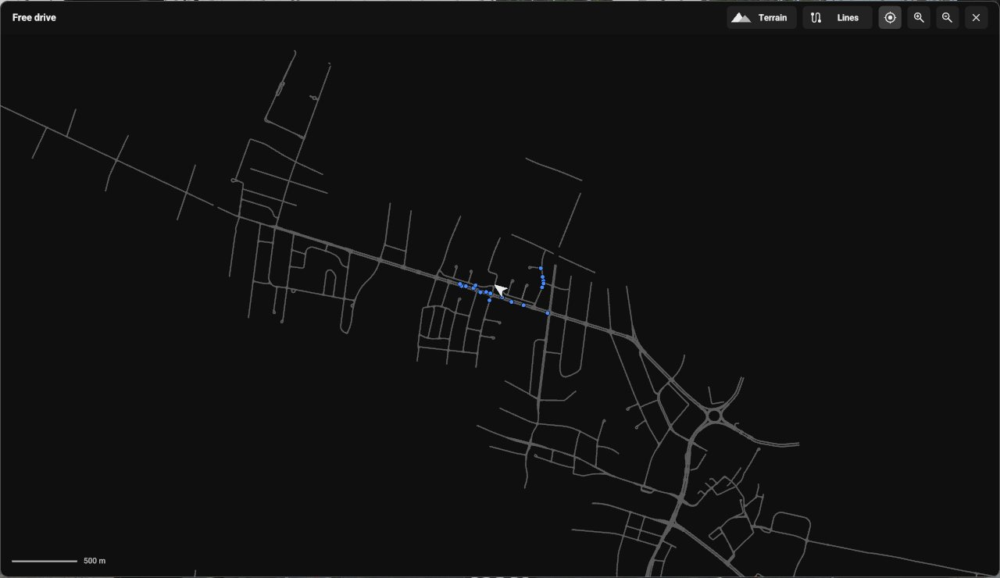 | 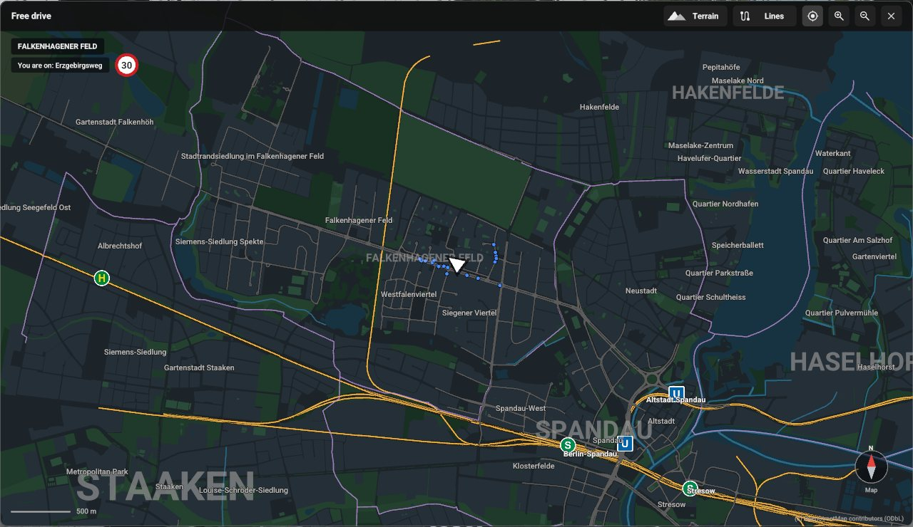 |

The lines of the map, from its own timetable, with a departure picked: the time at each stop on the map and in the list.

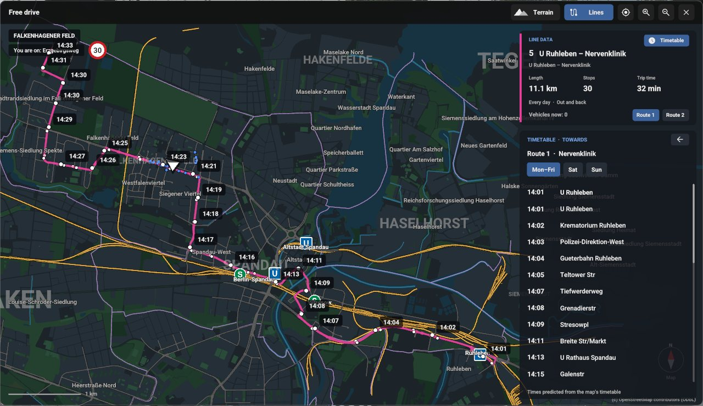

The relief of the real terrain (contour lines every metre of height, with the heights):

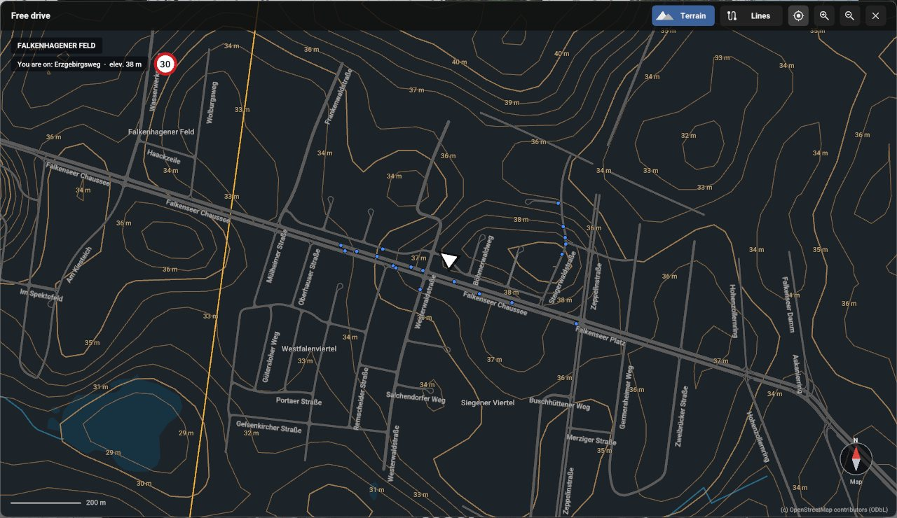

**Projekt Szczecin**: the map is not aligned with reality, so its package carries only the shore and the rivers of the real city, set by north and position, and the lines of the map. The roads stay the map's own, and none lies in the water.

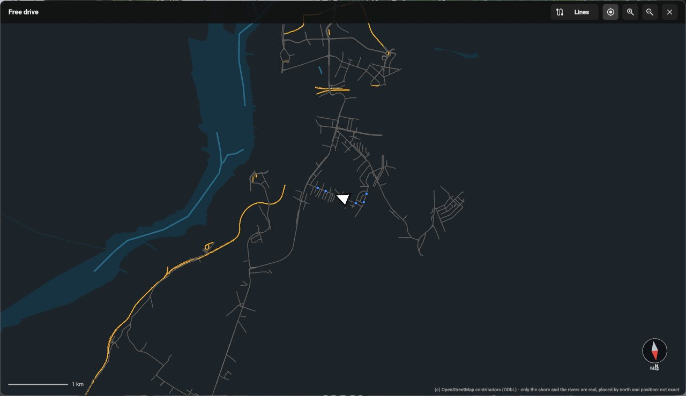

**Fikcyjny Szczecin**: a made-up map, so there is no real city to compare with: the package is measured from the map's own tiles (woods, buildings with their own outline, the railway, water courses, streets and the relief of its own ground).

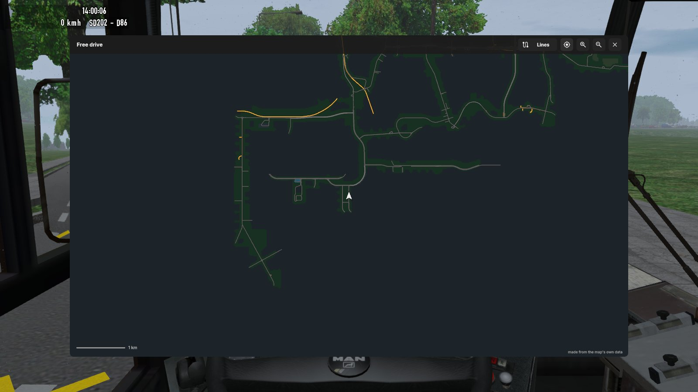

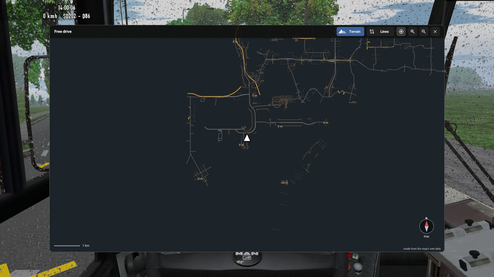

## Using a package

1. Copy the package's `openomsi-realmap` folder to `Maps/<Map>/openomsi-realmap/` in openOMSI's content folder (the folder next to
   `openomsi.exe`, where mods go). The OMSI 2 installation is never written to. Putting it in the installation's own
   `Maps/<Map>/` works as well.
2. Start the map and press Shift+M. `nav_surface=0` in the settings turns a package off.

## Making a package

[tools/mapgen](tools/mapgen/) makes a package for any OMSI 2 map in one run. It is plain Python, meant to be read and edited.
This section is the walk-through; the generator's own [README](tools/mapgen/README.md) says how it works inside.

### What you need

- Python 3 and `pip install numpy scipy pillow contourpy`.
- An OMSI 2 folder with the map (the one that holds `Maps`, `Vehicles`, ...). The generator only **reads** it.
- Internet, except in mode `own`: OpenStreetMap through Overpass (streets, water, rails), Nominatim (a place name) and public elevation
  tiles (only with `--relief`). Everything downloaded is kept in `tools/mapgen/cache` (`--cache` moves it), so a second run asks for nothing. Overpass is sometimes busy: run again in a few minutes.
- Time: a first run on a big map takes a while (the downloads); later runs use the cache. Nothing is written into the OMSI 2 folder.

### Which kind of map is yours?

```
Does the map have [worldcoordinates] in its global.cfg?
 |-- yes: does it sit on the real streets?             -> exact
 |        |-- a little off (up to ~120 m)              -> fitted
 |        '-- far off or out of proportion             -> shore
 '-- no:  is it a real city? give --at or --place      -> shore or fitted (it decides)
          is it a made-up place?                       -> own  (no OpenStreetMap at all)
```

You do not have to choose: with `--mode auto` (the default) the generator measures how well the map's roads agree with the real
streets, picks the profile and says why in `REPORT.md`. Force a mode with `--mode` only when you disagree with it.

### The modes, one by one

| | `exact` | `fitted` | `shore` | `own` |
|---|---|---|---|---|
| Use it for | a real city map placed on its coordinates | a real city map a little off the real one | a real city map not aligned or not in proportion | a fictional map, or when you do not want OpenStreetMap |
| OpenStreetMap | yes | yes | yes (water only) | no |
| Needs | `[worldcoordinates]` | `--at` or `--place` if the map has none | `--at` or `--place` | nothing |
| Water, rivers, green, woods | real | real, bent to the map | real, with **no road in water** | measured from the map's own tiles |
| Streets, districts, speed limits | real | real, bent to the map | not carried (the map's own roads are the truth) | not carried |
| Relief (`--relief`) | real terrain | real terrain | not carried | the map's own ground |
| Railway | the map's own rails | the map's own rails | the map's own rails | the map's own rails |
| Lines, stops, times, eras | from the map's own timetable, in every mode | | | |

**exact**: the map is on `[worldcoordinates]` and its roads fall on the real streets (median error 15 m or less, 90% within 50 m).

```
python mapgen.py --omsi "C:/Games/OMSI 2" --map "Berlin-Spandau" --relief 1 --out ./out/spandau
```

**fitted**: the real city must be bent by at most 120 m (90% of the roads) to meet the map. The generator finds the landmarks that agree
(stops with the same name, streets, neighbourhoods, bus routes of the same number) and bends the real layers with a smooth field.

```
python mapgen.py --omsi "C:/Games/OMSI 2" --map "My_City" --place "Curitiba, Parana, Brazil" --relief 5 --out ./out/mycity
```

**shore**: the map is out of proportion with the real city (it would have to be bent by more than 120 m). Only the **north and the
shore** are carried: water areas of 2 ha or more, rivers and canals, placed by north and position. Every road, stop, line and time is the
map's own, and the generator checks that **no road lies in water or within 16 m of it**, trimming the water where one does.

```
python mapgen.py --omsi "C:/Games/OMSI 2" --map "Projekt_Szczecin" --at 53.43,14.55 --timetables "C:/tmp/tram-unpacked" --out ./out/szczecin
```

**own**: a made-up place, or any map you do not want compared with the real world. The package comes from the map's own tiles: woods
(where tree objects are dense), buildings, water, sports grounds, rails, water courses and the relief of its own ground. What is what is
read from the **names** of the objects and spline files: the patterns at the top of `tools/mapgen/ownmap.py` (`TREES`, `BUILDINGS`,
`WATER`, ...) cover common names in several languages and are meant to be edited for the content of your map.

```
python mapgen.py --omsi "C:/Games/OMSI 2" --map "My_Fictional_Map" --mode own --relief 5 --north 0 --out ./out/mine
```

### Options that matter

| Option | What it does |
|---|---|
| `--map NAME` / `--map-dir PATH` | the map's folder under `Maps`, or the folder itself |
| `--at LAT,LON` / `--place "..."` | where the map is, for a map without `[worldcoordinates]`. `--place` is written as a person would and found through Nominatim. A point within a few km of the map is enough |
| `--radius KM` | how far round that point the stops are looked for (22 km by default; raise it for a big map) |
| `--mode auto\|exact\|fitted\|shore\|own` | the profile (default `auto`) |
| `--relief METRES` | contour lines every so many metres: 1 on a city, 5 on hills; 0 (default) none |
| `--north DEG` | mode `own`: degrees clockwise from the map's up to real north (0 if you do not care) |
| `--terrain-offset METRES` | mode `own`: added to the map's heights to get heights above sea level |
| `--timetables FOLDER` | more timetable files of the map (a tram network shipped as a separate pack); repeat for several |
| `--no-eras` | ignore the `Chrono` folders (the map's eras) |
| `--grid METRES`, `--min-splines N` | the tile size and how many splines make a tile count as the map, when the generator guesses wrong |
| `--name TEXT` | the map's name in the manifest |

### What comes out

A folder (`--out`) that becomes `openomsi-realmap`:

| File | What it is |
|---|---|
| `manifest.cfg` | north, alignment, vehicle kinds, colours (rails stand out from roads), credits |
| `surface.oms` | the picture: water, green, woods, rivers, rail, borders, streets with limits, contours (binary, in 2 km chunks) |
| `lines.lin` | the map's lines: ways, stops, itineraries, times, eras |
| `markers.cfg`, `regions.cfg`, `icons/` | stations and their pictograms, districts (when the profile carries them) |
| `REPORT.md` | **read it**: what was found, the mode and why, how far the real city was bent, how many lines, and the rules |

### Reading `REPORT.md`

- **Mode and why**: the measured numbers behind the choice. If a map you expect to be `exact` comes out `fitted`, its roads are off the
  real streets: look at the median and the 90% line.
- **Roads in water**: must be 0. The run ends with `RULE BROKEN` if not.
- **Jumps over 300 m** in a line's way: a stretch not found on the map's roads. A few at the ends are normal; many mean a timetable
  that refers to a road that is not in the tiles.

### Using the result

1. Copy the folder to `Maps/<Map>/openomsi-realmap/` in openOMSI's content folder (or the OMSI 2 installation's own `Maps/<Map>/`).
2. Start the map and press Shift+M. `nav_surface=0` in the settings turns it off.
3. Compare with the real world and run again with another mode or `--at` if it looks wrong. A package that is wrong is easy to delete:
   it is one folder and OMSI 2 itself never reads it.

### Customising the icons

The pictures on the map (stations and stops) are plain files, so you can change them without running the generator again.

**What the generator makes.** Three 96 x 96 pictograms in `icons/`, drawn by `tools/mapgen/icons.py` (no operator's logo in them):

| File | Picture | Used for |
|---|---|---|
| `stop.png` | yellow H on a green disc | bus and tram stops, and any station that is not metro or S-Bahn |
| `sbahn.png` | white S on a green disc | stations of rail lines whose number starts with S and a digit (S1, S25, ...) |
| `ubahn.png` | white U on a blue square | stations of metro lines |

`markers.cfg` has one line per station, and each line names the picture it uses:

```
# icon | width in pixels at interface size 1 | x | y | name
marker = icons/ubahn.png | 24 | 894181.3 | 4195744.7 | U Altstadt Spandau
```

**Change a picture for the whole package.** Replace the PNG in `openomsi-realmap/icons/` with your own, with the same name. Straight
(not premultiplied) alpha, up to 1024 x 1024 px; the generator's own are 96 x 96. The width on the map, in pixels at interface
size 1, is the second column of `markers.cfg` (24 for the generated ones).

**Use another picture for some stations.** Put the new PNG in `icons/` (any name, no `..` in the path), then edit the `icon` and the
width of the lines of those stations in `markers.cfg`:

```
marker = icons/terminal.png | 30 | 1200.5 | 840.0 | Central Terminal
marker = icons/depot.png    | 54 | 1650.0 | 410.5 | Bus depot
```

**Add a marker** (a terminal, a depot, a landmark): a new line with the place in **metres of the map's own grid** (the same numbers
as in the other lines), not latitude and longitude. A picture that cannot be read leaves out only its own lines.

**Without Pillow** the generator writes no icons and the stations are not drawn; install Pillow and run again, or put your own PNGs
in `icons/` and write the lines of `markers.cfg` yourself. A new run of `mapgen.py` writes `icons/` and `markers.cfg` again, so keep
your versions outside the output folder and copy them over the result.

**The player's marker** (the arrow of the bus) is changed in `manifest.cfg`, not with a picture: `player = triangle` and the colours
`player_free`, `player_line`, `player_brt` (see section 8.2 of [docs/MAP_PACKAGE.md](docs/MAP_PACKAGE.md)). The format of
`markers.cfg` is in section 8.1 of the same file.

### Later changes without a full run

```
python addrails.py --omsi "C:/Games/OMSI 2" --map "Projekt_Szczecin" --package path/to/openomsi-realmap [--replace]
```

puts the map's own railway (and the rail colours) into a package that exists already.

### A big city map: check and join the roads

Maps with dual carriageways, medians and many junctions can have a road network that looks right but is broken for routing (a road in
two pieces, tiny blobs, groups that touch nothing). `tools/mapgen/audit.py`, `dedupe.py` and `connect.py` find and mend those; what
goes wrong, how each error is found and the numbers measured are in [docs/ROAD-NETWORK.md](docs/ROAD-NETWORK.md).

### When something goes wrong

| Symptom | Probably | Do |
|---|---|---|
| Overpass 504 or a timeout | the public server is busy | run again; the cache keeps what was fetched |
| the map is placed in the wrong city | no `[worldcoordinates]` and the first guess was far | give a closer `--at`, or a `--place` with the district; raise `--radius` |
| `shore` when you expected `fitted` | the real city had to be bent too much | accept it (the map's roads are the truth), or force `--mode fitted` and look at the picture |
| lines without stops on the map | stop names OpenStreetMap does not have | normal; the stops are the map's own anyway |
| a rail drawn as a road | the rail lanes were not recognised | run `addrails.py` with `--replace` |
| woods or buildings wrong in `own` | the object names do not match the patterns | edit the patterns at the top of `ownmap.py` |

### Share it

Put the package in `packages/<name>/` with a README that names the **map and its authors**, the mode, the exact command that made it
and its data. Credit OpenStreetMap contributors (ODbL). Never include files of the map (tiles, textures, models, scripts): a package
holds only what was worked out from them.

## More results

The pictures of the work in openOMSI (city map Shift+M, small map Shift+N, launcher), all taken with a development build and the packages of this repository.

**The surface under the roads, with and without a package** (city map and small map, dark and light):

| Without | With |
|---|---|
| 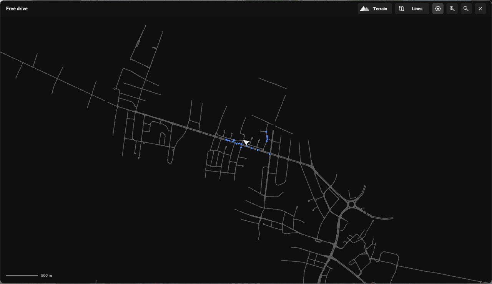 | 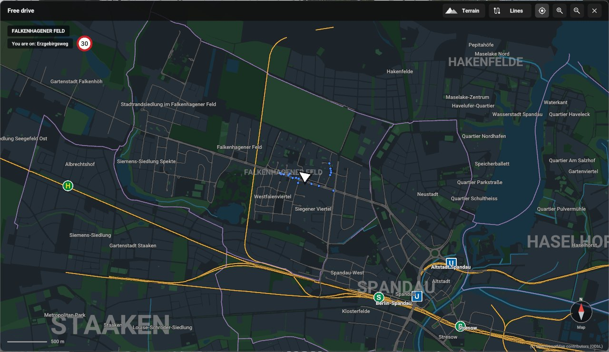 |
| 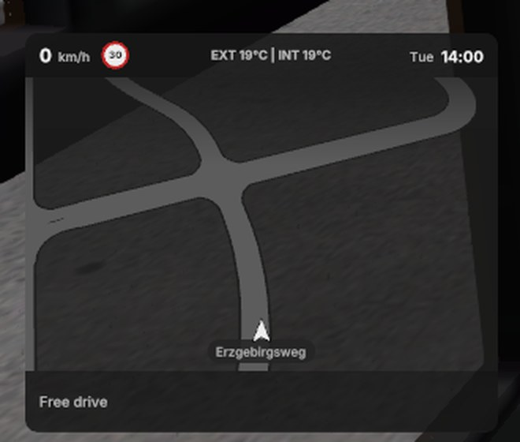 | 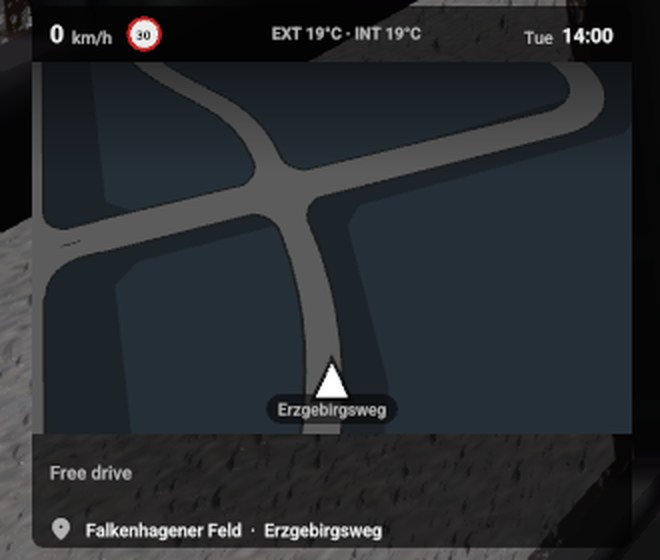 |
| 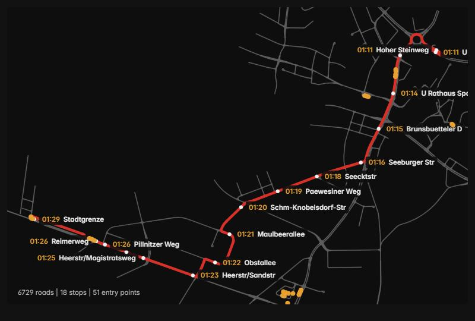 | 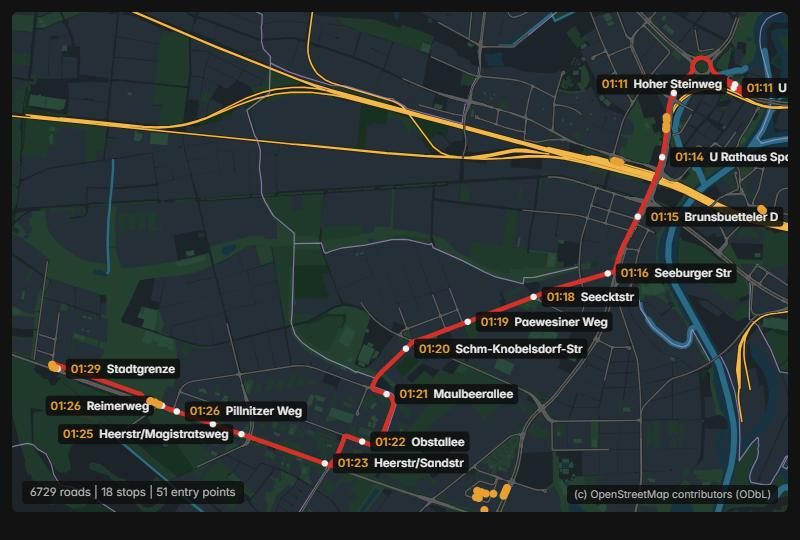 |

**Names, icons, the street and the district under the bus** (Berlin-Spandau, far and near, and the row of the small map):

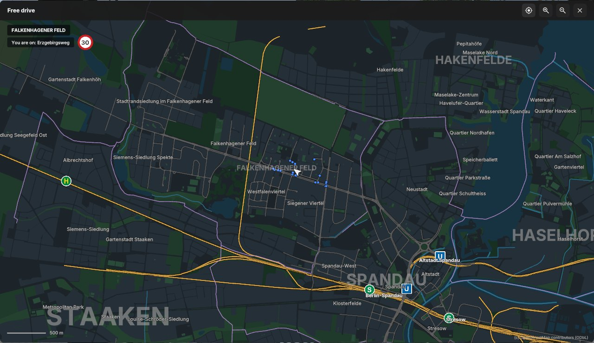
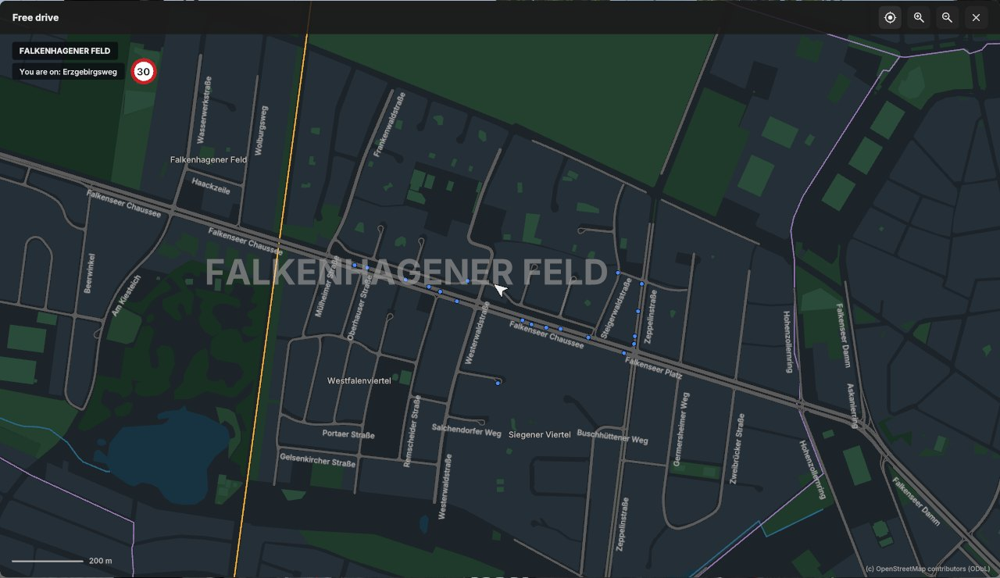
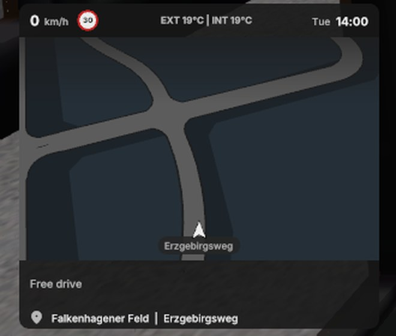

**The lines panel** (Berlin-Spandau: every line of the map, one opened with its routes):

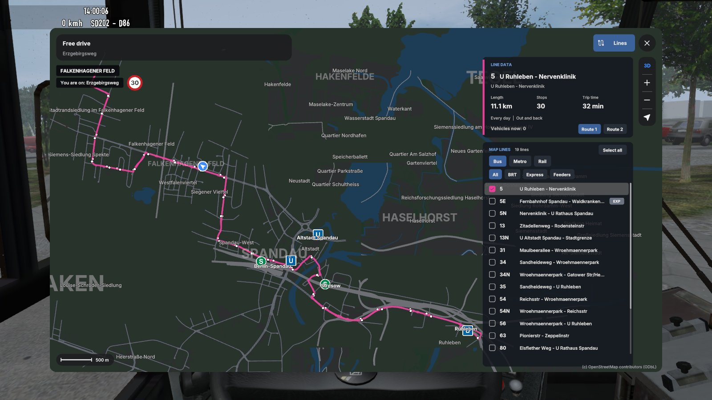
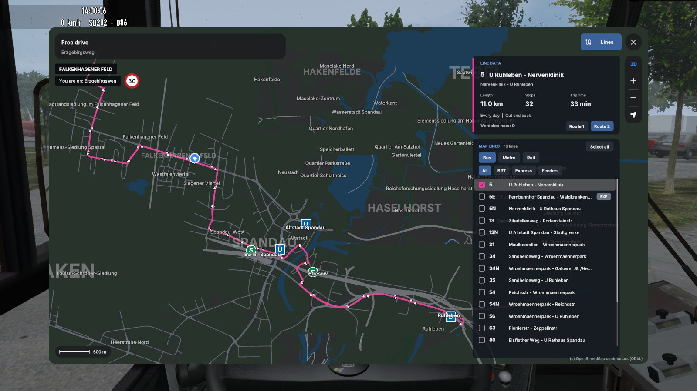

**The synthetic example** that ships with openOMSI (no data of OMSI 2 or OpenStreetMap), with a bus and a tram line:

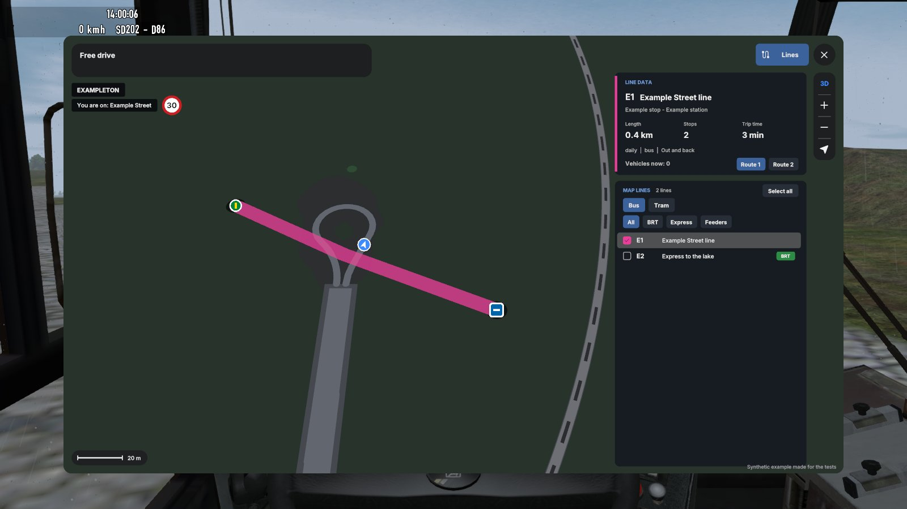 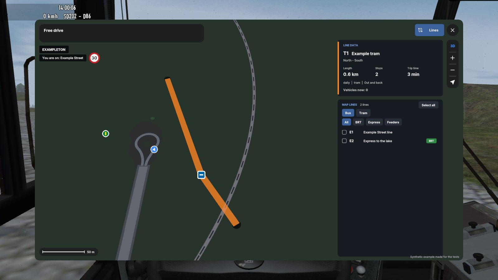

## What changed in the generator

The scripts of [tools/mapgen](tools/mapgen/) changed in these ways (details in its [README](tools/mapgen/README.md)):

- **More from a map's own files.** `o3d.py` reads the meshes of the map's objects and `footprints.py` takes the **outline of each building** from them, so
  mode `own` draws buildings as they stand and not as boxes. Objects outside the area of the map are left out.
- **Names in six languages.** `patterns.py` sorts the objects and splines of a map (trees, buildings, water, sports grounds, rails, streets) by their
  names in English, German, Polish, Portuguese, Spanish and French; the lists are plain regular expressions meant to be edited. A line called
  "METROPOLITANO" is no longer taken for a metro line.
- **Spline attachments.** The `[splineAttachement]` rows of a map (kerbs, fences, rails laid along a spline) count where the map has them.
- **Streets in every mode.** A street is a road whose first lane is a street lane; it is drawn as a line of class 3 and, when OpenStreetMap is in use, takes the
  name from it. Where the map's roads are wrong the map is wrong: the generator does not guess a street from its name.
- **A network layer that copes with busy servers.** `osm.py` asks four Overpass servers in turn, lets a failing one rest, obeys `Retry-After`, keeps a
  pause between queries, falls back from Nominatim to Photon, says how many queries are left and how long they should take, and keeps every
  answer. New options `--overpass URL` (repeatable) and `--pause SECONDS`; `python test_osm.py` tests it without a network.

## Credits

The maps belong to their authors, who must be credited when a package is shared: **Berlin-Spandau** (stock map of OMSI 2, by its developers),
**Projekt Szczecin** (mpaw82 and tomass94, with Kruchu, Darek59 and Nick™) and **Fikcyjny Szczecin** (MrYanke$ and the people he thanks).
The full list, with what each one made, is in [CREDITS.md](CREDITS.md). OpenStreetMap data: (c) OpenStreetMap contributors, ODbL 1.0.

## AI

This project is developed with an AI partner, Claude Sonnet 5.5: see [AI_DISCLAIMER.md](AI_DISCLAIMER.md).

## Licences

Code and documentation: MIT ([LICENSE](LICENSE)). The OpenStreetMap data inside the packages: ODbL 1.0
([LICENSE-DATA.md](LICENSE-DATA.md)). Credit the maps and their authors when you share a package.
