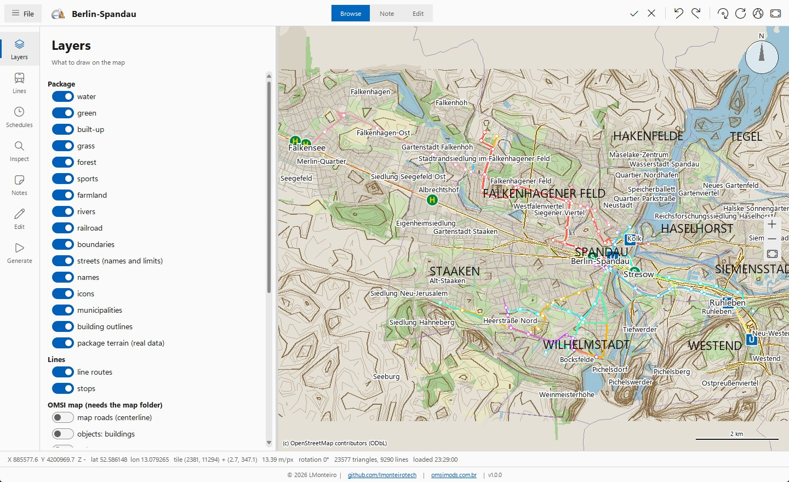
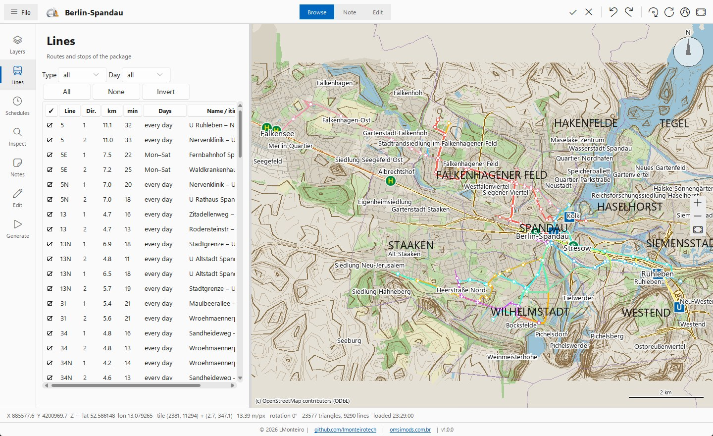
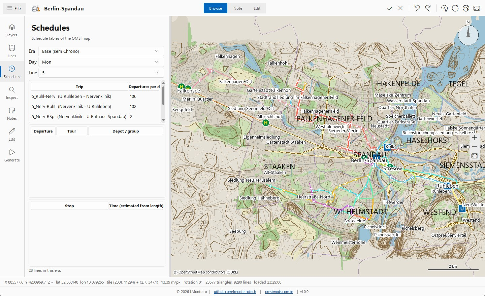
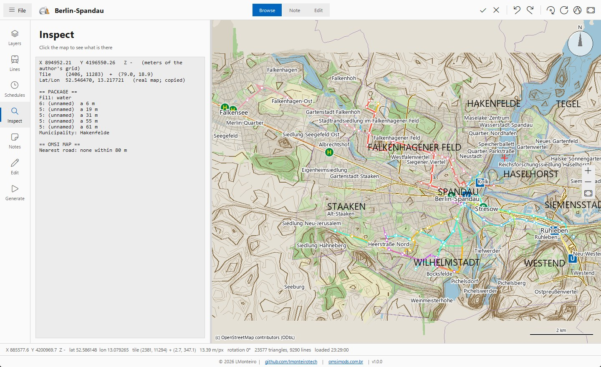
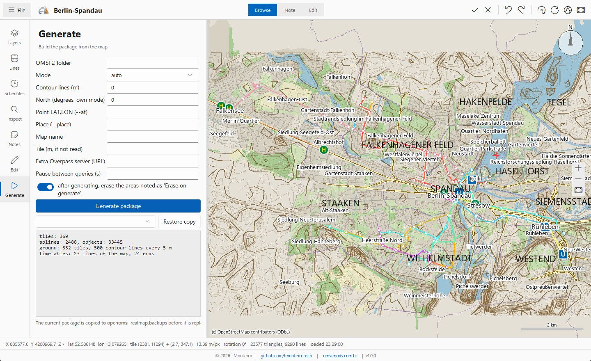

# openOMSI/openHUD Map Package Creator

**ombr-mapcreator.exe**: a Windows program to **look at, check, annotate, edit and generate** the map packages (`openomsi-realmap`) of this repository, without opening the game.
The whole generator ([tools/mapgen](../tools/mapgen/)) is inside the same file, so you need no Python. Portuguese: [README.pt-BR.md](README.pt-BR.md).

© LMonteiro · [leomonteiro.eti.br](https://leomonteiro.eti.br) · [github.com/lmonteirotech](https://github.com/lmonteirotech) · [omsimods.com.br](https://omsimods.com.br)

> **Freeware, not open source.** Free to use and to share unchanged and complete; not to modify, reverse engineer, sell or rebrand: see [EULA.txt](EULA.txt),
> [LICENSE.txt](LICENSE.txt) and [THIRD-PARTY-NOTICES.txt](THIRD-PARTY-NOTICES.txt). The packages it makes are yours to share (credit the maps and their authors).

## Install

1. Download `ombr-mapcreator-v1.0.0-windows.zip` from the [releases](https://github.com/lmonteirotech/openomsi-map-packages/releases) (the `app-v1.0.0` one).
2. Unzip it anywhere and run `ombr-mapcreator.exe`. There is nothing to install and nothing is written outside the folders you choose and your own settings
   (`%APPDATA%`).
3. Windows may show the "unknown publisher" screen the first time (the file is not signed): *More info > Run anyway*.

The program only **reads** your OMSI 2 folders. It writes the package folder you ask for (a copy of the one it replaces is kept in `openomsi-realmap.backups`).

## The window

Left, a rail of seven pages; right, the map. Drag moves, the wheel zooms, **the right button rotates**, a click inspects, a double click fits the whole map.

### 1. Open a package or a map

**File > Select...** (Ctrl+O) takes a package folder, a map folder (`Maps/<Map>`, with or without a package) or an OMSI 2 installation. If the package is inside a map
folder, the map is read in the background; otherwise use **File > Associate OMSI map folder**. The window watches the files and reloads by itself when the generator or an editor
changes them.

### 2. Layers



Everything the package draws (water, green, built-up, grass, forest, sports, farmland, rivers, railroad, boundaries, streets with their names and limits, names, icons,
municipalities, building outlines, the real terrain), the routes and stops of the lines, and, from the OMSI 2 map (needs the map folder), its own roads, objects and ground.
Switches turn each one on and off. The map under everything is OpenStreetMap, when a map is real (it can be turned off and its opacity changed).

### 3. Lines



The lines and directions of `lines.lin` with check boxes, filters by kind (bus, tram, metro, rail) and by weekday, and their length and trip time. Ticked lines are drawn on the
map with their stops.

### 4. Schedules



From the map's own timetable files (`TTData`): the era (the base or each `Chrono` folder), the weekday, the line, the trip, the day's departures and the stops of a trip with their
times (estimated from the length of the way). A selected trip is drawn on the map.

### 5. Inspect, Notes, Edit



- **Inspect:** click the map for the position (X Y Z, latitude and longitude on real maps), the tile, what the package says there and what the OMSI 2 map says.
- **Notes:** mark points and areas as *Wrong*, *Improve*, *Erase when generating* or *Checked*. They are saved beside the package (`openomsi-realmap.notes.json`; the game never reads it).
- **Edit:** erase an area by class, paint an area, name a street and give its speed limit, delete a line, move or delete an icon. Every action writes the package and can be undone
  (Ctrl+Z / Ctrl+Y).

### 6. Generate



Runs the generator on the associated map. Fill in:

| Field | What it is |
|---|---|
| OMSI 2 folder | the folder that holds `Maps` and `Vehicles` (read only) |
| Mode | `auto` (it decides and says why), `exact`, `fitted`, `shore` or `own` (a made-up map, no OpenStreetMap): see the [README](../README.md#making-a-package) |
| Contour lines (m) | the relief: 1 on a city, 5 on hills, 0 for none |
| North (degrees, own mode) | degrees clockwise from the map's up to real north |
| Point LAT,LON / Place | where the real city is, for a map without coordinates |
| Map name, Tile | the name in the manifest; the tile size if it is not read from the map |
| Extra Overpass server, Pause between queries | for busy OpenStreetMap servers: another server and a longer pause |

**Generate package** runs it (the log shows what is happening, and a generation goes on if you change language or theme). The result replaces the package, with a copy in
`openomsi-realmap.backups`; **Restore copy** brings a copy back.

## Keys

`F` fit · `Q`/`E` rotate 15° · `0` north up · `L` light/dark map · `G` tile grid · `N` names · `I` icons · `T` routes · `R` reload · `Ctrl+Z` / `Ctrl+Y` undo / redo.

## Look and languages

Dark, light or the system's look (File > Theme). 17 languages (File > Language): English (US, the main one), Portuguese (Brazil, Portugal), English (UK), French, German, Spanish
(Spain, Latin America), Italian, Polish, Dutch, Russian, Chinese (simplified, traditional), Japanese, Hungarian and Turkish; the first run follows the system. The translations were made with the help of
an AI and may need corrections: tell us.

## Command line

The same file is the generator, with no window:

```
ombr-mapcreator.exe [folder]                                   opens the window
ombr-mapcreator.exe gen --omsi "C:/Games/OMSI 2" --map Projekt_Szczecin --mode own --relief 5 --out ./out/szczecin
ombr-mapcreator.exe rails|audit|dedupe|connect|check ...      the other tools of tools/mapgen, same arguments
```

## Compatible with

openOMSI, Project Depot, and OMSI 2 through OmsiLaunch and openHUD: see the [README](../README.md#compatibility).
This program is independent and is not affiliated with or endorsed by them or by the owners of OMSI 2. It is developed with an AI partner: see [AI_DISCLAIMER](../AI_DISCLAIMER.md).
